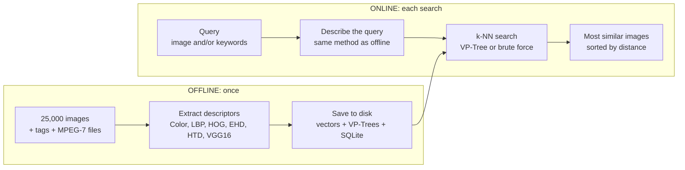

# CBIR: textual and visual image search over MIRFLICKR-25k

A content-based image retrieval (CBIR) engine for the 25,000 images of
MIRFLICKR-25k, built **without Elasticsearch**:

- **6 visual descriptors**: Color (HSV), LBP, HOG and VGG16, all computed here,
  plus the provided MPEG-7 EHD and HTD,
- a custom **VP-Tree** index (one per descriptor and metric), plus **brute force** for comparison,
- a **FastAPI** server exchanging JSON, a plain **HTML/CSS/JavaScript** client,
  and **SQLite** for image paths, tags and metadata,
- keyword search with **typo tolerance**, weighted **combination of descriptors**,
  a **fuzziness** control, and an **evaluation** module (precision, recall, mAP, timings).

---

## 1. Architecture

The work is split into two phases, as in the course: an **offline** phase that
computes everything once and saves it to disk, and an **online** phase that
loads those files at start-up and answers queries.



The images themselves never move. They stay in their folder and the server
serves them under `/images/...`. The database only stores their path.

---

## 2. How a search happens

1. **Keywords (optional).** Each keyword is expanded to close tags (typo
   tolerance with rapidfuzz, e.g. `sunst` becomes `sunset`), then the SQLite tag
   index returns the matching images (AND / OR).
2. **Query image.** For a database image or a clicked result, its precomputed
   vectors are read. For an uploaded image, the descriptors are computed with
   the same parameters as offline (`manifest.json`).
3. **Search.** With one descriptor: VP-Tree or brute force over the 25,000
   images. With several: the combined distance `D` below (VP-Tree mode
   re-ranks the candidates of each tree). With keywords and an image: brute
   force on the keyword-filtered images only.
4. **Filter and answer.** The query image itself is removed, the fuzziness
   filter is applied, and the server returns JSON (image URLs, distances, tags,
   search time, index used, distance computations). The browser shows the
   results, and clicking one starts a new search with it as the query.

**Combined distance D.** When several descriptors are ticked, each distance
`d_i` is divided by that descriptor's scale `s_i`, the median distance between
2,000 random image pairs, computed offline. This puts all descriptors on the
same scale. The scaled distances are then averaged with the user weights:

```
D(q, x) = ( sum_i  w_i * d_i(q, x) / s_i ) / ( sum_i w_i )
```

**Fuzziness.** The combined distance is min-max normalized to [0, 1] over the
database, and a result is kept when its normalized distance is at most
`f x` that of the K-th result. The database minimum is the best result `d_1`,
and the maximum cancels out of the inequality, so the rule is exactly
`(d_i - d_1) / (d_K - d_1) <= f`. No full scan is needed, so it also works with
the VP-Tree. `f = 100 %` gives the plain top-K. Lower values keep only the
matches close to the best one, possibly fewer than K. For keywords, the same
slider controls typo tolerance: at 0 % only exact tags match, and at 100 % a tag
matches with a `fuzz.ratio` similarity of 70 or more.

---

## 3. The index: VP-Tree

A **vantage-point tree** (`backend/index/vptree.py`) organizes the vectors by
distance only, so it works with any metric (L1, L2, histogram intersection).

**Construction.** Choose a vantage point `vp`, compute `d(vp, x)` for all
other points, and split at the median `mu`: the *inner* child gets `d <= mu`,
the *outer* child gets `d >= mu`. Each child stores the range `[lo, hi]` of
`d(vp, x)` over its points. Recurse until a node has at most 512 points, which
then form a leaf "bucket". The tree is balanced, with 127 nodes for 25,000
images.

**Search (k nearest neighbours).** The triangle inequality gives, for any point
`x` in a child, `d(q, x) >= max(lo - d(q, vp), d(q, vp) - hi)`. If this lower
bound is larger than `tau`, the distance of the K-th best result found so far,
nothing in that child can enter the top K, and the whole subtree is skipped.


The search is **exact**: it returns exactly the brute-force results, which
`tests/test_vptree.py` and the evaluation check. One tree is built per
(descriptor, metric) pair, 13 in total.

---

## 4. Descriptors

| Descriptor | Source | Dim | Default metric | How it is built |
|---|---|---|---|---|
| **Color** | computed | 128 | histogram intersection | HSV joint histogram, 8 (H) x 4 (S) x 4 (V) bins, L1-normalized |
| **LBP** | computed | 28 | L1 | uniform rotation-invariant patterns (riu2), scales (P,R) = (8,1) and (16,2) |
| **HOG** | computed | 3780 | L2 | grey 64x128, 8x8 cells, 9 orientations, 2x2 blocks, L2-Hys |
| **EHD** | provided (MPEG-7) | 150 | L1 | 80 local + 5 global + 65 semi-global edge bins |
| **HTD** | provided (MPEG-7) | 43 | L1 | texture vector (non-standard length), z-score per dimension |
| **VGG16** | computed (CNN) | 512 | L2 | ImageNet VGG16 conv blocks on 224x224, global average pooling, L2-normalized |

- Each descriptor module has a docstring explaining its method in detail (`backend/descriptors/`).
- **Same pipeline offline and online.** The parameters are saved in
  `artifacts/manifest.json` at indexing time and read back by the server, so an
  uploaded image is described exactly like the indexed ones. Uploading
  `im1.jpg` returns image 1 at distance 0.
- **Uploads** support Color, LBP, HOG and VGG16. EHD and HTD are provided files
  that exist only for database images, so the UI disables them for uploads.
- **Histogram intersection** `1 - sum(min(a, b))` equals `0.5 x L1` on
  normalized histograms, so it is a true metric and can be indexed by the VP-Tree.

---

## 5. Results (100 random queries, 25,000 images)

A result is **relevant** if it shares at least one of the 24 MIRFLICKR concept
labels with the query. The labels are broad (people, sky, structures...), so a
random ranking already reaches **P = 0.564**.

| Configuration | P@10 | mAP@20 |
|---|---|---|
| **VGG16** | **0.892** | **0.841** |
| Color + LBP + VGG16 | 0.831 | 0.728 |
| Color + LBP + HOG | 0.727 | 0.591 |
| LBP (L2) | 0.697 | 0.535 |
| Color (intersection) | 0.650 | 0.499 |
| EHD (L2) | 0.578 | 0.399 |
| HTD (L2) | 0.544 | 0.372 |
| HOG (L2) | 0.508 | 0.345 |

| Descriptor (dim) | VP-Tree query | Brute force query | Distances computed by the VP-Tree |
|---|---|---|---|
| LBP (28) | 0.6 ms | 0.9 ms | **21 %** of the database |
| HTD (43) | 4.3 ms | 2.9 ms | 38 % |
| EHD (150) | **13.1 ms** | 19.4 ms | 61 % |
| Color (128) | 4.2 ms | 5.4 ms | 82 % |
| VGG16 (512) | 34.7 ms | 33.4 ms | 100 % |
| HOG (3780) | 393 ms | 214 ms | 100 % |

The VP-Tree skips most of the database for low-dimensional descriptors. In high
dimension (HOG, VGG16) all distances become similar and nothing can be pruned:
the *curse of dimensionality*. All figures and CSV files are in
`report_assets/`.

---

## 6. Project structure

```
backend/
  config.py            paths and descriptor parameters (overridable by environment variables)
  main.py, schemas.py  FastAPI app and JSON models
  engine.py            online search: loading, combination, fuzziness
  descriptors/         color.py, lbp.py, hog.py, vgg16.py, mpeg7.py, preprocess.py
  index/               vptree.py, bruteforce.py, distances.py (L1, L2, intersection)
  db/                  database.py (SQLite), metadata.py (parsers), fuzzy.py (typo tolerance)
frontend/              index.html, app.js, style.css
scripts/               build_index.py, extract_vgg16.py, run_evaluation.py
tests/                 test_vptree.py (VP-Tree = brute force)
report_assets/         evaluation CSV files, figures, summary
```

---

## 7. Installation and usage (Windows PowerShell)

### Data (not included in the repository)

The dataset and the generated index are too large for Git. Place the data like
this:

```
data/
  mirflickr/                  im1.jpg ... im25000.jpg, doc/, meta/ (tags, exif, license)
  annotations/                *.txt concept label files (mirflickr25k_annotations_v080)
  mpeg7/edgehistogram/        1.txt ... 25000.txt (150 values each)
  mpeg7/homogeneoustexture/   1.txt ... 25000.txt (43 values each)
```

### Setup

```powershell
py -3.12 -m venv .venv
Set-ExecutionPolicy -Scope Process -ExecutionPolicy RemoteSigned
.\.venv\Scripts\Activate.ps1
pip install -r requirements.txt
pip install torch torchvision --index-url https://download.pytorch.org/whl/cpu   # for VGG16 (CPU)
```

### Run

```powershell
# 0. (optional) check that the VP-Tree returns exactly the brute-force results
python -m tests.test_vptree

# 1. OFFLINE: descriptors + SQLite + VP-Trees (~8 min); add --limit 1000 --out artifacts_test for a quick test
python -m scripts.build_index

# 1b. OFFLINE: VGG16 features (CPU, 40-70 min, resumable: run the same command again after Ctrl+C)
python -m scripts.extract_vgg16

# 2. ONLINE: start the server, then open http://127.0.0.1:8000
uvicorn backend.main:app --port 8000

# 3. Evaluation: CSV + figures + summary in report_assets/
python -m scripts.run_evaluation
```

After a new `build_index`, run `extract_vgg16` again. If the images did not
change, it only re-registers the VGG16 descriptor without recomputing it.
`python -m scripts.build_index --trees-only` rebuilds only the VP-Trees.

### Using another image base (e.g. the "Objects" base)

```powershell
python -m scripts.build_index --images-dir D:\objects --no-mpeg7 --out artifacts_objects
$env:CBIR_ARTIFACTS_DIR = "artifacts_objects"; uvicorn backend.main:app --port 8000
```

All paths can also be set with the environment variables `CBIR_IMAGES_DIR`,
`CBIR_META_DIR`, `CBIR_ANNOTATIONS_DIR`, `CBIR_MPEG7_DIR` and
`CBIR_ARTIFACTS_DIR`.

### API

| Method | Route | Purpose |
|---|---|---|
| GET | `/api/config` | descriptors, metrics, parameters |
| GET | `/api/random?n=` | random images for the gallery |
| GET | `/api/images/{id}` | metadata, tags and labels of an image |
| GET | `/api/tags/suggest?prefix=` | tag autocomplete |
| POST | `/api/search` | search (JSON body) |
| POST | `/api/search/upload` | search with an uploaded image (`file` + `params` JSON) |

Interactive documentation: `http://127.0.0.1:8000/docs`.

### Evaluation protocol

- Ground truth: the 24 MIRFLICKR "potential" concept labels.
- **Relevant** = shares at least one concept label with the query. The query is
  excluded from its results, and only labelled images are used as queries.
- 100 random queries (seed 42). Metrics: P@K, R@K and mAP@K for K = 10 and 20,
  per descriptor and metric, for several combinations, and for a random baseline.
- VP-Tree vs brute force: build time, average query time (k = 20), share of
  distance computations, exactness, and scalability from N = 1k to 25k.
